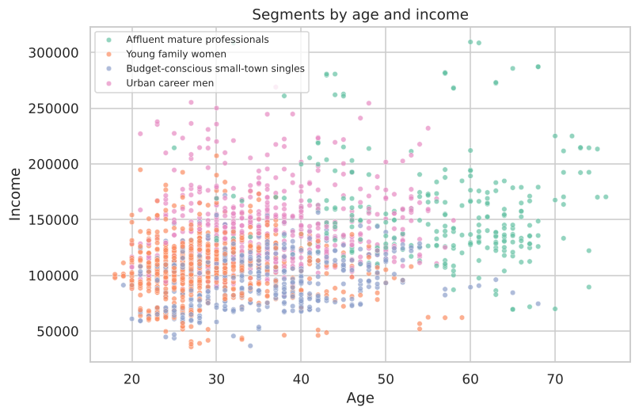
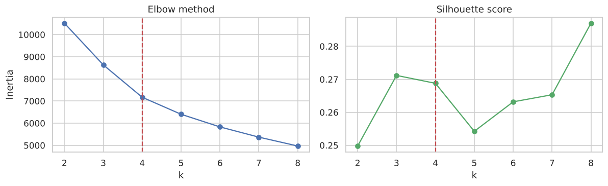

# Customer Segmentation with K-Means

**Which customer groups exist, and how should marketing talk to each one?**

This project segments 2,000 customers into four personas using K-Means on age, income, education, occupation, marital status, sex and city size, and gives each persona a concrete marketing approach.



## Segments

| Segment | Share | Profile | Suggested approach |
| --- | --- | --- | --- |
| **Young family women** | 35% | ~29 years, almost all non-single, 85% women, high school, small cities, income ~106k | Family bundles, instalments, social and community channels |
| **Urban career men** | 28% | ~36 years, 97% men, mostly single, skilled or management roles, mid/big cities, income ~141k | Premium and convenience products, app-first channels |
| **Budget-conscious small-town singles** | 23% | ~36 years, single, 96% small cities, two-thirds unemployed or unskilled, income ~98k | Value products, promotions, local partners |
| **Affluent mature professionals** | 13% | ~56 years, university or graduate degree, highest income ~158k | High-value products, loyalty programmes, personal service |

## Method

1. Checked data quality: no missing values and no duplicates.
2. Standardised all seven attributes so income does not dominate.
3. Chose k with the elbow method and silhouette score. The elbow bends at k = 4; silhouette is flat at 0.25–0.29 for k = 3–8, so k = 4 was picked for clarity and actionability.
4. Fitted K-Means (k = 4), profiled each cluster, and visualised them with PCA.



**Limitation:** a silhouette of ~0.27 means the segments overlap. The personas are practical groupings, not hard boundaries.

## Project structure

```
├── customer_segmentation.ipynb   # full analysis
├── build_notebook.py             # rebuilds and re-executes the notebook
├── nbrun.py                      # small helper that executes cells and stores outputs
├── data/customer_segmentation.csv
└── images/
```

**Run it:** `pip install -r requirements.txt`, then open `customer_segmentation.ipynb`.

## Context

Rebuilt from my *Conqueror Project 2* in the Digital Skola Data Science Bootcamp (2026). Data: public customer segmentation teaching dataset. Category codes follow the dataset's legend.

---
Muhammad Irsyad Dzulfaqor · [LinkedIn](https://www.linkedin.com/in/mirsyaddzulfaqor/) · [GitHub](https://github.com/mirsyaddzulfaqor-tech)
